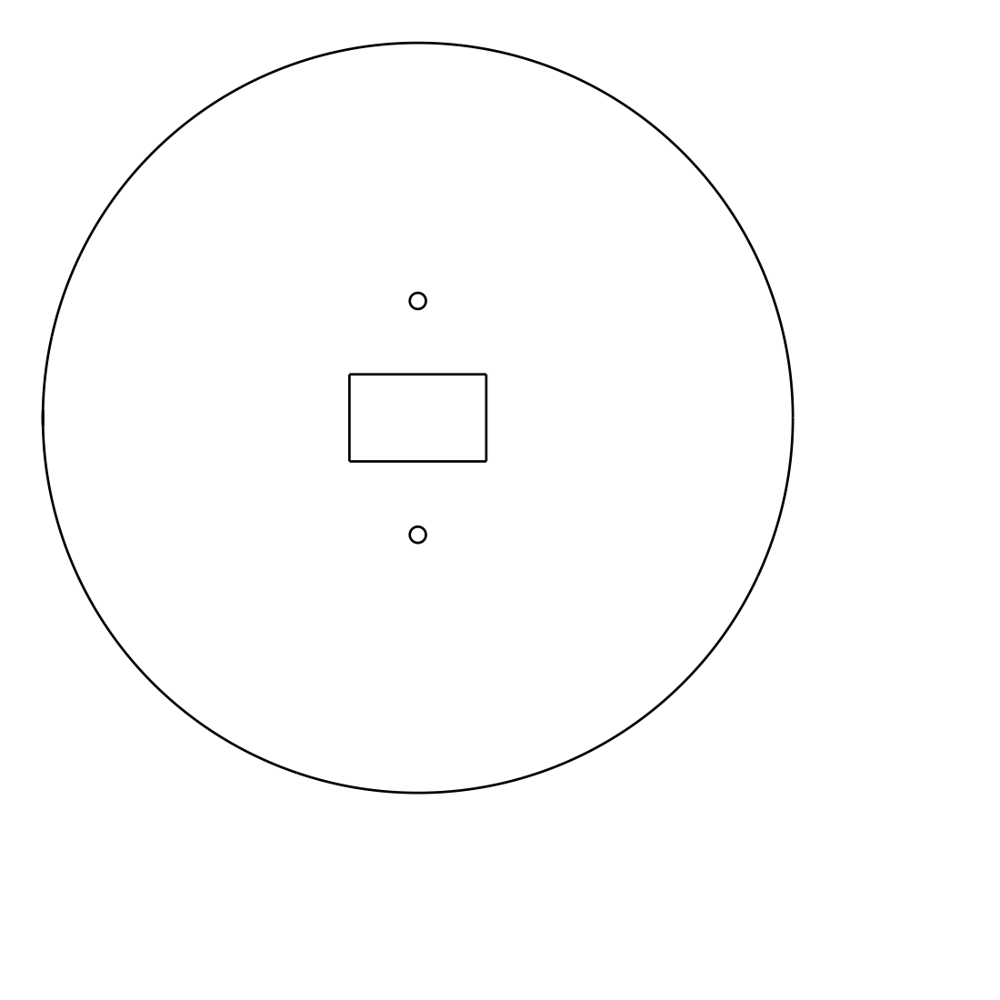

# Paddy water-level tube (PETG)

**Status: first draft, 2026-10-13. Modelled only. Nothing is printed or tested, and the sensor has not arrived.**

Three printed parts for the water-level sensor described in [`docs/WATER_SENSOR_PLAN.md`](../../docs/WATER_SENSOR_PLAN.md).

| Part | File | Size (mm) | What it does |
|---|---|---|---|
| Tube cap | `exports/tube_cap.step` | 124 × 121 × 35 | Slips over a VU100 pipe. Has the window the sensor looks through and three vent grooves. |
| Sensor lid | `exports/sensor_lid.step` | 37 × 47 × 10 | Holds the ToF unit face down over the window and keeps rain off. Two M3 screws. |
| Float | `exports/float_target.step` | 94 across × 14 | An upturned cup with a flat top for the sensor to see. Glue foam inside. |

`water-tube-animation.html` shows the assembly and how the sensor reads the water.

## Stake parts (added 2026-10-13)

Three more parts, from `stake.py`. **Modelled only.** None of the electronics or the panel has arrived, so no size here is checked against a real part.

| Part | File | Size as printed (mm) | What it does |
|---|---|---|---|
| Chassis | `exports/stake_chassis.step` | 100 × 54 × 132 | An upright plate with a floor. The battery, charger, controller and LoRa board tie onto its grid of holes. |
| Cover | `exports/stake_cover.step` | 106 × 46 × 135 | A hood that slides down over the chassis and hooks behind it. One M3 screw at the bottom front holds it. |
| Panel bracket | `exports/panel_bracket.step` | 98 × 165 × 110 | Holds the solar panel at 30°. A lip catches the panel's lower edge; four slots take straps. |

All three strap to a round stake with zip ties in a V-shaped saddle, so they fit any stake from about 15 to 30 mm across.

**How the box keeps rain out.** It is not sealed. The cover is closed on top, front and sides and open underneath, and it overlaps the back plate, so there is no seam facing up. Cables and the antenna leave through the floor. This sheds rain but will not survive being submerged or sprayed from below, so mount it well above the highest water level.

**Inside size:** 100 wide × 125 tall × 36 deep. The parts it has to hold, from their published sizes: lithium cell 50 × 34 × 10, charger board 29 × 19, ATOMS3 Lite 24 × 24 × 10, LoRa board 36 × 21 (48.5 with its antenna socket). Nothing is shaped to one board. Fix each with a zip tie, an M3 screw or foam tape through the 10 mm hole grid.

**Antenna:** mount the LoRa board with its socket pointing down. The antenna hangs through the slot in the floor, below the box.

| Part | Print orientation (as exported) | Notes |
|---|---|---|
| Chassis | Upright, floor on the bed | No supports. The saddle's underside is cut at 45° for this. |
| Cover | Upside down, top on the bed | No supports. |
| Panel bracket | On its side | No supports. It is the largest print: about 5–6 hours. Use 15 % infill; solid it would weigh 414 g. |

**Known limits**

- The panel size (251 × 140 × 18 mm) is from the shop page. The bracket's lip is cut for an 18 mm thick panel. If the frame is a different thickness, change `PANEL_T`.
- The panel is 251 mm wide and the bracket 110 mm, so the panel overhangs 70 mm each side. Strap it firmly; wind will try to lift it.
- 30° tilt is a reasonable year-round angle for Japan. Change `TILT` to adjust.
- No receiver case for the house end. That board sits indoors and its size is not confirmed.

## Change a size

Edit the `PARAMETERS` block in `sensor.py` (tube parts) or `stake.py` (stake parts) and re-run. Do not edit the exported files.

```bash
pip install cadquery
python sensor.py
python stake.py
```

The script also checks that the parts do not overlap each other, the pipe or the sensor unit.

## Check before printing

| Assumed | Value | Source |
|---|---|---|
| Pipe outside diameter | 114 mm | Nominal VU100. **Measure your pipe.** |
| Pipe inside diameter | 107 mm | Nominal. **Measure.** |
| Sensor unit | 32 × 24 × 8 mm | Switch Science product page |
| Sensor position on the unit | Unknown | **Check the 22 × 14 mm window covers it.** |

## Print settings

| Part | Orientation | Notes |
|---|---|---|
| Tube cap | As exported: flat top on the bed | No supports. |
| Sensor lid | As exported: top on the bed | No supports. |
| Float | As exported: flat face on the bed | No supports. The bed side becomes the smooth target face. |

The exported files are already upside down and sitting on the bed, so do not re-orient them. Load them as **separate objects**. (Before 2026-10-13 they were exported in their positions on the pipe, where the float and the lid hide the sensor window from both sides.)



PETG, 0.2 mm layers, 4 walls. A white or light filament keeps the cap cooler and gives the sensor a brighter float.

## Screws: no printed threads

Nothing here has a modelled thread. An M3 thread is too fine to print cleanly, and the pipe has none. Every screw hole is a plain 2.6 mm hole and the M3 screw cuts its own thread as it goes in.

| Screw | Where | Thread depth |
|---|---|---|
| 2 × M3 × 10 | Lid to cap | 9 mm (3 mm plate plus a 6 mm boss underneath) |
| 1 × M3 × 10 | Side of the cap, pressing on the pipe | 6 mm (skirt plus an outside rib) |

The cap itself is a slip fit on the pipe; the side screw only stops it lifting off. Drive the screws in slowly the first time. A self-cut thread in PETG survives a handful of removals. If the lid will come off often, melt M3 heat-set inserts into the lid holes and enlarge `SCREW_PILOT` to suit them.

## Assembly

1. Drill 5 mm holes all round the lower 200 mm of a 400 mm pipe and wrap that part in fine mesh.
2. Push the pipe 200 mm into the soil. Scoop the mud out of the inside.
3. Drop the float in, flat face up.
4. Fit the cap and tighten the M3 screw in its side.
5. Lay the sensor face down over the window, cable toward the slot, and screw the lid on.
6. Run the cable to the controller on a stake.
7. Calibrate: measure from the sensor to the soil once, and compare the first readings with the staff gauge.

## Known limits

- Printed PETG is not watertight. The float relies on the foam, not on the print.
- The lid sheds rain but is not sealed. Put a bead of neutral-cure silicone round it once the sensor is proven.
- Nothing here protects the controller. It needs its own box on the stake.
